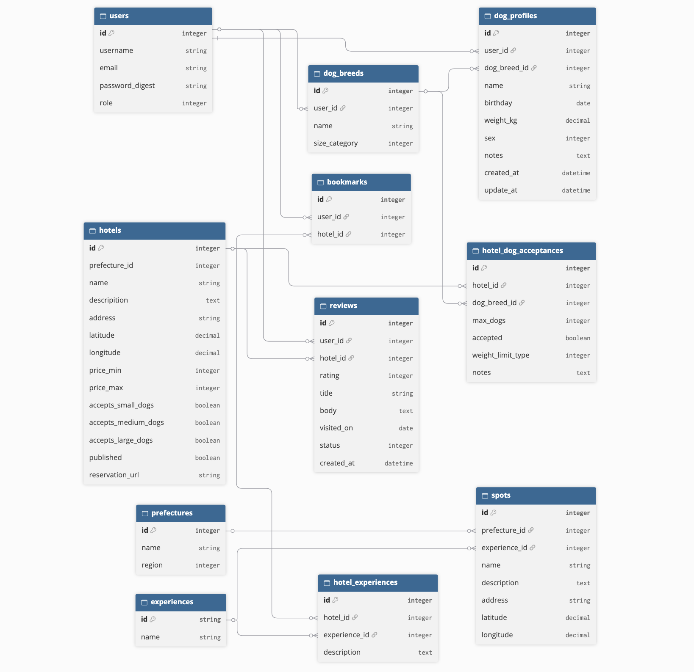

OneVel(ワンベル)

## １. サービス概要

  愛犬にしてあげたいことを探せるペット宿検索アプリ。
  地域で探せることはもちろん、愛犬が楽しめる体験を軸に検索できること（宿を起点に観光地を一緒に巡りたい、自然豊かな土地で一緒にお散歩したい、
  ドッグランで自由に走り回らせたい、宿の食事を食べさせたい、etc...）を軸に宿探しができるアプリを目指します。

---

## ２. 制作背景
   
   私は過去に愛犬２匹と暮らしましたが、犬の一生は人間と比べたらずっと短く、高齢になれば自宅周辺しか出掛けられなくなる。
   もっと元気なうちに色々な場所に一緒に出かければよかったと後悔することがあります。そうした思いをする人が少しでも減らせるように、
   愛犬にしてあげたいことをさせてあげられる場所を探せる検索アプリを作りたい、そう思いこのアプリの作成に至りました。

---

## ３. 課題の整理
 ### 3-1. 現状のペット宿検索サイト
 
  ペット宿専門サイト自体数社しかなく、その他は旅行サイトの特集ページでペット宿が紹介されている。
  専門サイトも宿タイプ別の検索が多く、目的（ドッグランやプール付きなど）で検索できるサイトは限られている。
  こういうことをしたいとすでに考えてる人や場所じゃなくて何かしたいと考えてる人には現状の検索方式だと希望を叶えにくい。

### 3-2. 解決したい課題

  - 犬向け設備がある宿は探せても、どのような体験ができるかがわかりにくい。
  　：１つ１つこの宿では何ができるか？と確かめる必要があり、比較検討するのが大変である。
  　　まとめて検索結果に出るようにしたら比較検討るす手間がかなり減る。
  - 宿と周辺の愛犬とお出かけできる情報を別々に調べる必要がある。
  　：まず宿を決めその後に周辺の情報を調べる、この工程には多少の手間がかかる。
  　　一箇所にまとめるとその手間が解消される。

---

## ４. 想定ユーザー

   ### 4-1. メインユーザー(MVP機能、本リリースではメインユーザー向けの機能を作成)

   #### 年齢：３０代　
      理由：犬の飼育世帯が１番多い世代
   #### 生活状況：仕事とプライベートのバランスを考え始める
   　　理由：上記に加えて２０代に比べて金銭的余裕が出始める人が多くなる年代だから
   #### 環境：宿は検索しやすいが、何をしたいかで迷う人が多い
   　　理由：宿を検索するサイトがネット検索をすると多くヒットするから。
   　　このアプリでは宿の検索ではなく、何をするか(何を体験できるか)で検索できる。
  　
  ### 4-2. その他のユーザー

  宿を運営している方を想定。運営者が宿情報変更申請を通じて修正依頼やアピールポイントなどを提供、メインユーザーにアピールできる場を提供する。
  (本リリース後に機能を作成)

  ### 4-3. 自分とユーザーの距離

  - 過去の自分がユーザーと近い距離感である
  - なぜその距離感なのか？
  　過去の自分が何をするかに迷っていたし、現在のサイト検索でもそれを解消できるサイトがないので、
  　利用するユーザーと近い目線でアプリを作成できると思ったから。

  ### 4-4. 実際に使われる可能性
  
  - 最初に使ってくれそうな人
  ：愛犬との旅行を考えている人
  - どんな場面でこのアプリを思い出すか？
  ：愛犬と何をしようか考えた時
  - 今の代替手段は？
  ：宿検索サイトにてその宿で何ができるか１つ１つ確認して宿検索をしている
  - 今の手段から置き換える理由は？
  ：宿検索ではなく、何ができるか(体験)から検索できる

  ### 4-5. ユーザーが導入して利用するまでのイメージ
  　体験したい内容を５つのカテゴリーから検索できるので、その選択肢を見ることで一緒に出かけるイメージを考えやすくし、
  　実際に体験したいと思ってもらう。また、愛犬プロフィールにて旅行での事前準備のサポートや実際に行った宿のリスト(本リリース後に作成予定)
  　をユーザーに登録してもらうことで、次の旅行への一助としてもらい、このアプリで検索してもらいやすくする。
---

## ５. 競合調査

   ### 5-1. 競合サービス
   #### サービス名：pet宿.com
   URL：https://petyado.com/
   
   - 主なターゲット
      - 愛犬と泊まれる宿を探している人
   - 強み
      - エリアと宿タイプ別で検索が可能
      - ドッグランや犬用食事メニューありなどをサイト独自のマークで表示してホテルの特徴を表現している
  - 弱み
    - ホテルの特徴と都道府県での同時検索ができない
    - ペットへの情報と飼い主へのホテル情報が混在して箇条書きされている

  #### サービス名：INUYADO(いぬやど)
  URL:https://www.pet-inu-yado.com/

   - 主なターゲット
     - 宿の特徴やわんちゃん用設備で細かく宿検索したい人
   - 強み
     -  検索するときの選択肢が多い
     -  サイト独自の割引制度あり
     -  掲載情報が細かく記載
   - 弱み
     -  周辺情報が薄い

### 5-2. 自分のアプリとの差別化

  #### 宿に宿泊する主人公は愛犬であること、愛犬が快適に楽しく過ごせる宿の情報を周辺情報含め提供していく
   - 検索の起点：愛犬に体験させたいこと
   - 絞り込み：エリア×犬種×目的
   　　→目的は次の５つのカテゴリーから選択する。
       ①ドッグランやアジリティ設備がある宿、②森林散策や自然公園散策など宿周辺の散歩環境重視、
  　　　③犬用プール、水遊び可能な設備がある宿、④犬用メニューに加え、記念日向けのメニューもある食事を楽しめる宿、
  　　　⑤犬同伴可能な観光スポットにアクセスがしやすい宿
   - 宿の詳細：愛犬向け設備・サービスを中心に掲載
   - 周辺情報：散歩スポット・愛犬と訪問できる場所

---

## ６.　このサービスが提供する価値

愛犬と過ごす宿を探す過程で、愛犬が何が好きなのかを再確認できる。
普段の生活では知り得ない愛犬のことを知るきっかけになる。
愛犬にしてあげたいことで宿検索（場所よりも目的メインで検索）できる。

          
---

## ７.実装内容

 ### MVPで作る機能

 #### 管理者サイド
  - 宿新規登録機能
  　(宿の基本情報に加え、周辺スポットを個別に登録。体験カテゴリーの分類はこの時点で管理者が選択。
  　　地図上への反映は本リリースにて行う。)
  - 宿更新・削除機能

#### 閲覧者サイド
  - 新規会員登録機能
  - ログイン、ログアウト機能
  - 愛犬プロフィール作成機能（会員のみ利用可能）
  　(名前や誕生日などの基本情報に加え、旅行に行った時の気づきや必需品のメモ機能で旅行準備のサポートをする。
  　将来的には訪れた旅行先をリスト形式で表示、プロフィールと検索機能との連携は未定)
  - 宿詳細画面
  　(宿の基本情報と周辺スポットを記載)

#### サイト画面
  - エリア別検索機能
  - 犬種別検索機能
  　(体験から検索する機能の絞り込み機能が基本だが、泊まれる宿だけをまず見たい人向けに犬種だけで検索できるように機能付け)
  - 愛犬にさせたい体験から宿を検索する機能
  　→５つのカテゴリーで検索：①ドッグランやアジリティ設備がある宿、
  　 ②森林散策や自然公園散策など宿周辺の散歩環境重視(宿の周辺状況と宿への聞き取りにて分類する)、
  　　③犬用プール、水遊び可能な設備がある宿、④犬用メニューに加え、記念日向けのメニューもある食事を楽しめる宿、
  　　⑤犬同伴可能な観光施設にアクセスしやすい宿(宿から15km以内に観光施設が複数ある宿を分類する)

### 本リリースで作る機能
  - 口コミ投稿機能（会員のみ利用可能）
  - お気に入り登録機能（会員のみ利用可能）
  - アプリ訪問者のアクセス解析機能（GA4）
  - 地図の検索機能（マーカー表示、マーカークリックで簡易情報を表示）
  - 周辺スポットの検索範囲追加（近隣の公園やお散歩コース、観光施設、etc...）

### 収益化
  - 広告表示
  - 宿泊予約アフィリエイト
  - 旅行用品のアフィリエイト

---

## ８. このアプリの懸念点とその対策
#### アプリ利用者の利用動向が不明瞭である。
対策：アクセス解析（GA4）を導入、これをアプリ改善にも利用する。
#### 宿情報の正確性
対策：宿の公式サイトの確認や直接電話確認することで宿情報の正確性を保つ。
また、将来的に宿運営者からの変更申請機能を実装することでより精度の高い情報を提供する。

---

## ９. 今後の展望
  - 口コミをスライドショー形式でサイト上に表示
  - 閲覧数を元にピックアップ表示をトップページに掲載
  - ユーザー機能(愛犬プロフィール)に訪れた宿の記録をリスト形式で表示
  - SNSを活用した訪問者数増加への取り組み（任意の宿をピックアップ紹介.etc...）
  - 宿運営者のユーザー登録機能
  - 宿運営者からの宿詳細情報の変更申請（受付・確認中・変更済みのステータスを表示）
  - 管理者サイドの運営者からの変更申請一覧（未対応、対応済みのステータスを表示）

---

## １０. 技術スタック
### 10-1. 使用予定の技術
#### フロントエンド
 - React + Vite（画面構成）
 ：宿泊施設の検索画面や詳細画面などを構築
 - TypeScript（画面構成）
 ：宿泊施設や愛犬プロフィールなどのデータの型を定義
 - Tailwind CSS（デザイン）
 ：スマホやPCに対応したレイアウトを実装
 - Google Maps JavaScript API（地図表示）
 ：宿泊施設の位置を地図上に表示、簡易情報を表示できる機能を実装
 - React Router（ページ遷移）
 ：トップページから宿泊施設一覧などの画面遷移を管理

#### バックエンド
 - Ruby
 ：Ruby on Railsとの互換性が高い
 - Ruby on Rails(API)
 ：Reactからのリクエストを受け取り、宿泊施設の登録、更新、削除などの処理を実行
 - Active Storage（宿の画像管理）
 ：Onevel内の画像のアップロード、保存などを管理
 - Ransack（宿の絞り込み機能）
 ：検索条件を組み合わせて実行する
 - Pundit（権限管理）
 ：一般と管理者の権限分けを管理
 - bcrypt（パスワードのハッシュ化）
 ：ユーザーのパスワードをハッシュ化して保存
 - kaminari（ページネーション）
 ：ページを複数に分割しデータ量の調整を行う
 - RSpec（テスト）
 ：設定した機能の動作確認
 - Geocoder（住所の座標変換）
 ：宿泊施設の緯度、経度を基に検索処理に使用
 - Google Geocoding API（住所から緯度・経度を取得）
 ：登録住所から緯度、経度に変換し、Googleマップに表示

#### インフラ・その他
 - PostgreSQL（データベース）
 ：Railsと相性が良く、安定した管理ができる
 - Docker（開発環境）
 ：開発環境をコンテナで構築し、環境差異を抑えて開発可能
 - Git/GitHub（ソースコード管理）
 ：ソースコードの変更履歴の管理、バックアップを行う

### 10-2. 技術選定の比較検討
 - React + Vite or Rails + Hotwire
 ：Rails+HotwireはRailsのフォーム、バリデーションなどを一体的に利用でき、かつMVPの開発工数を抑えやすい。
 しかし、今回作成するアプリでは複数条件での絞り込み機能が最も重要になるため操作性の高いReact+Viteを選択

 - Google Maps JavaScript API　or Mapbox GL JS
 ：Mapboxは地図の細かいデザインや演出を設計可能だが、地図での宿のピン刺しと簡易情報の表記のシンプルなデザインで充分な為
 それらが可能でかつユーザーの使い慣れたGoogleマップの使用を選択
 
 -  今回チャレンジしたい点
 ：Rails +α(新しい技術) で学びながら卒業制作を進めていきたい。

 - 不安な点
 ：学習量がどのくらいになるのかが不明、対策として本リリースに予定している地図表記を時間によっては削減する。
 (地図表記は卒業制作完成後の今後の展望へ変更して機能追加させる)
 　
### 10-3. Reactのキャッチアップ状況
学習カリキュラム(Reactマスター)で学習した内容のみ

---

## １１. ER図

